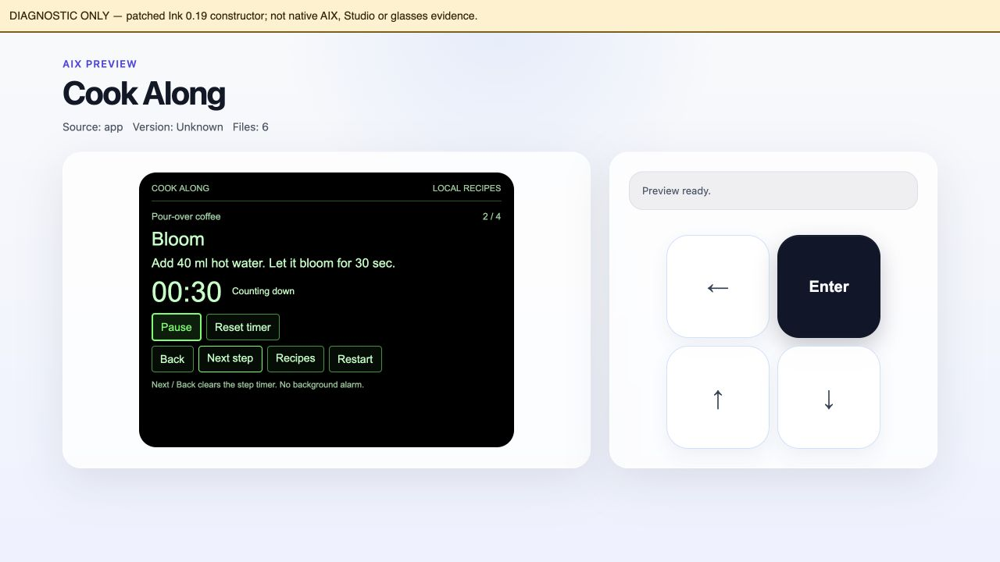
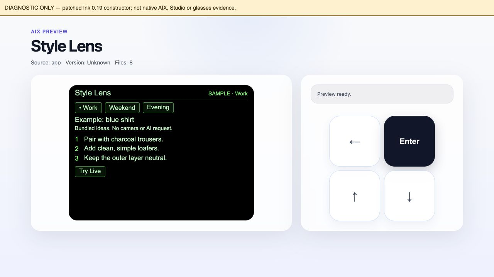

# Rokid AIUI Starter Kit

[English](README.md) | [简体中文](README.zh-CN.md) | 日本語

ハッカソン向けの、編集可能な AIUI 0.19.0 デモプロジェクトを2つ用意しています。デモを出発点に、コーディングツールで [Rokid AIUI Agent DevKit Skill](https://github.com/BreezeLife/rokid-aiui-agent-skill) を使い、自分の作品に変更できます。

**デモを選ぶ → DevKit をインストールして読み込む → 変更する → 検証する → Studio と眼鏡で実演する。**

Starter Kit は独立した [GitHub リポジトリ](https://github.com/BreezeLife/rokid-aiui-starter-kit) で管理します。Skill は別のリポジトリにある開発ツールで、App の実行には必要ありません。Starter Kit をクローンし、そのフォルダーをコーディングツールで開いてください。

```bash
git clone https://github.com/BreezeLife/rokid-aiui-starter-kit.git
cd rokid-aiui-starter-kit
```

GitHub からリポジトリの ZIP をダウンロードし、展開したフォルダーを開くこともできます。

## 出発点を選ぶ

| デモ | 実演できること | ネットワークとキー | Studio のインポートディレクトリ |
| --- | --- | --- | --- |
| [Cook Along](demos/cook-along/README.ja.md) · 食 | コーヒーまたはパスタを選び、手順を進め、タイマーを開始・一時停止・再開する | アプリの API、アカウント、キーは不要。開いた後の主要機能はオフラインで動作 | `demos/cook-along/app` |
| [Style Lens](demos/style-lens/README.ja.md) · 衣 | 場面を選んで3つの提案を表示。Live モードでは衣服を撮影して提案を取得 | Sample モードは内蔵テキストを使うため API・キー不要。Live モードにはカメラ権限、HTTPS バックエンド、チームトークン、サーバー側の画像モデル用キーが必要 | `demos/style-lens/app` |

初期の App UI は**英語**です。開発手順は英語・簡体字中国語・日本語で用意しています。どちらも通常のプロジェクトで、追加の Skill ではありません。今後、DevKit の構成を変えずに生活シーンを追加できます。

## デモのスクリーンショット

以下の画像は、修正した Ink 0.19.0 で実際に取得した診断用ブラウザーのスクリーンショットです。リンク先の動画は実際の画像を編集して構成した実演で、連続したリアルタイム録画ではありません。画像または動画リンクから再生できます。AIUI Studio・物理眼鏡・実モデル接続のエビデンスではありません。

[](demos/cook-along/media/demo.mp4)

[約30秒の Cook Along 実演を見る（MP4）](demos/cook-along/media/demo.mp4)

Cook Along：レシピの手順と動作中のタイマー。

[](demos/style-lens/media/demo.mp4)

[約30秒の Style Lens 実演を見る（MP4）](demos/style-lens/media/demo.mp4)

Style Lens：Sample と明示された例示の提案と場面の選択。実モデルの結果は表示していません。

## 最短手順：インポート → 実行 → 変更

クローン後に [DevKit を一度インストールして読み込み](#1-devkit-をインストールして読み込む)、次の順に進めます。

1. **インポート：**上の正確なパスを使い、選んだ `demos/<name>/app` を AIUI Studio にインポートします。
2. **実行：**Cook Along でレシピを選ぶか、Style Lens を Sample で開きます。どちらの初期フローも API キーは不要です。
3. **変更：**DevKit とデモの3つの依頼例を使って下の1か所を変更し、Starter Kit のルートで[依存関係のインストールとローカル検証](#3-ローカル検証を実行する)を行います。開き直すか再インポートして変化を確認します。

| デモ | 1 · データ | 2 · UI | 3 · プロンプトまたは API 設定 |
| --- | --- | --- | --- |
| Cook Along | [recipes.js](demos/cook-along/app/lib/recipes.js) | [index.ink](demos/cook-along/app/pages/index.ink) | [Agent のプロンプト](demos/cook-along/app/AGENTS.md) |
| Style Lens | [samples.js](demos/style-lens/app/data/samples.js) | [index.ink](demos/style-lens/app/pages/index/index.ink) | [API 設定](demos/style-lens/app/config.js) |

[Cook Along ガイド](demos/cook-along/README.ja.md#最短手順インポート--実行--変更)と [Style Lens ガイド](demos/style-lens/README.ja.md#最短手順インポート--実行--変更)に、最短の導入・実行・変更手順とコピーできる3つの Vibe Coding 依頼例があります。Style Lens はキー不要の Sample と別途設定できるバックエンドを用意しています。[バックエンド配置ガイド（英語）](demos/style-lens/server/README.md)にローカル Node.js、Docker/Compose、HTTPS コンテナーサービス向けの手順があります。配置と実モデル接続の検証は別途必要です。

## 1. DevKit をインストールして読み込む

Agent Skills に対応し、このワークスペースの読み書きとターミナルコマンドの実行ができるコーディングツールを使います。Skills インストーラーには Node.js **22.20 以降**、ローカル検証には Python 3 も必要です。まず [Skill とスクリプト](https://github.com/BreezeLife/rokid-aiui-agent-skill/tree/main/skills/rokid-aiui-agent) を確認してください。

Codex の場合、ターミナルで実行します。

```bash
node --version
npx skills add BreezeLife/rokid-aiui-agent-skill --skill rokid-aiui-agent --agent codex --global
npx skills list --agent codex --global
```

一覧に `rokid-aiui-agent` が表示されることを確認します。インストール元は Skill リポジトリのデフォルトブランチです。更新時はインストールを再実行し、取得した revision を確認してください。

| コーディングツール | `--agent codex` の置き換え | チャットでの読み込み |
| --- | --- | --- |
| Codex | `--agent codex` | 依頼に `$rokid-aiui-agent` を含める |
| Claude Code | `--agent claude-code` | `/rokid-aiui-agent` で始める |
| Cursor | `--agent cursor` | `/` を入力して `rokid-aiui-agent` を選び、依頼を書く |

インストールと一覧表示の両方で同じ置き換えを使います。検出されない場合はセッションを開き直し、インストール時と開発時で同じマシン・ユーザーを使っているか確認してください。編集前に Skill を読ませ、実際の `SKILL.md` のパスを報告させます。インストール成功だけでは今回の読み込みを確認できません。詳細は [DevKit 利用ガイド](https://github.com/BreezeLife/rokid-aiui-agent-skill/blob/main/docs/usage.ja.md) を参照してください。

## 2. 最初の変更を行う

Starter Kit フォルダーを開いてデモを選び、次の依頼をターミナルではなく**チャット欄**に送ります。Codex 向けの例なので、他のツールでは上表の呼び出し方に変更してください。

```text
$rokid-aiui-agent
このプロジェクトの AGENTS.md と継続管理ファイルを読み、インストール済みの
Skill を読んでパスを報告してください。demos/cook-along/app をお茶の淹れ方
ガイドに変更してください。AIUI 0.19.0、英語 UI、ローカルデータ、手順移動、
タイマーの一時停止・再開を維持し、app を単独でインポート可能にしてください。
テストと厳格な検証を行い、インストール済み AIX CLI が対応する操作を実行し、
プロジェクト UX 表と機能別の表を更新してください。ソース・成果物の正確な
パスと実行結果を報告し、未実施の Studio・実機確認は BLOCKED にしてください。
```

各デモの README に変更対象ファイルと3つの依頼例があります。まず内容を変え、その後に操作を変更すると進めやすくなります。テスト、バックエンド、レポート、生成した `.aix` は `app/` の外に置きます。

## 3. ローカル検証を実行する

Starter Kit のルートで実行します。

```bash
npm ci --ignore-scripts --no-audit --no-fund
npm test
npm run verify
```

`npm test` は App とバックエンドの決定論的テストを実行し、有料モデルには接続しません。`npm run verify` は同じテストを再実行し、外部 DevKit を使って AIUI 0.19.0 の厳格な検証、ソースフィンガープリント、機能インベントリを生成します。Skill が見つからない場合は、`SKILL.md` と `scripts/` を含む実際のディレクトリを `AIUI_SKILL_DIR` に設定します。

```bash
# 例示用パスです。実際に解決された Skill ディレクトリに変更してください。
export AIUI_SKILL_DIR="/absolute/path/to/rokid-aiui-agent"
npm run verify
```

固定した AIX 依存関係を次のスクリプトで使います。スクリプトは CLI のヘルプを確認し、対応する操作だけを実行します。同じルートで実行してください。パッケージ作成には Bash も必要です。

```bash
npm run preview -- cook-along
npm run preview -- style-lens
npm run pack
```

プレビュー HTML は `output/previews/` に生成します。HTML 生成は描画成功を証明しません。パッケージ作成では両デモを確認し、インポートルート外の `output/packages/` に一意の名前で `.aix` を出力します。アーカイブは編集可能なソースの追加成果物です。

### 任意のブラウザー診断用プレビュー

未修正のプレビューに後述の起動エラーがある間、別の診断用ツールで UI を確認できます。ツールはチェックサムで固定した公式 Ink 0.19.0 パッケージを取得し、Git 管理対象外の `output/previews/diagnostic-runtime/` だけに互換パッチを適用します。App は変更せず、標準プレビューの結果も PASS には変わりません。Node.js と Python 3 が必要です。

```bash
npm run preview:diagnostic -- cook-along
npm run preview:diagnostic -- style-lens
python3 -m http.server 8768 --bind 127.0.0.1 --directory output/previews
```

ローカルサーバーを起動したまま、[Cook Along の診断ページ](http://127.0.0.1:8768/cook-along-diagnostic.html)または [Style Lens の診断ページ](http://127.0.0.1:8768/style-lens-diagnostic.html)を開きます。各ページに修正済みランタイムの表示があります。限定的なレイアウト・クリック確認に使い、Studio・実機の結果は別に記録してください。終了時は Ctrl+C でサーバーを止めます。

## 4. インポートして実演する

AIUI Studio では、**`app.json` が直接入った正確な `app/` ディレクトリ**を選びます。

```text
Cook Along: demos/cook-along/app
Style Lens: demos/style-lens/app
```

Starter Kit フォルダーからの相対パスです。リポジトリ全体、デモの親フォルダー、サーバー、`.aix` をソースのインポートルートには使いません。

**GitHub からのインポート**では、共通のリポジトリと ref を指定し、デモごとの正確なディレクトリを選びます。

```text
Repository: https://github.com/BreezeLife/rokid-aiui-starter-kit
Ref: main
```

| Demo | Directory |
| --- | --- |
| Cook Along | `demos/cook-along/app` |
| Style Lens | `demos/style-lens/app` |

`main` は現在の開発ブランチです。以前の検証を再現する場合は対応する commit を選び、その検証レポートの App フィンガープリントと照合してください。

各デモ README の短い実演手順を使います。各デモが宣言する表示先を確認します。Cook Along は会話内 `_current` と全画面 `_blank`、Style Lens は `_blank` を使います。フォーカスとタップ、エラーからの回復、終了と再起動を確認し、対象の Rokid Glasses でも検証してください。Cook Along のローカル処理は、ホストのオフライン起動を証明しません。Style Lens の Sample モードも、カメラや実際のモデル接続の検証にはなりません。

## 検証状況

App・バックエンドの決定論的テストと、AIUI 0.19.0 の厳格なソース検証は合格しました。実行した検証とパッケージの結果は [verification/README.md](verification/README.md)、DevKit と公式ソースの固定 revision は [verification/source-pins.json](verification/source-pins.json) を参照してください。ローカル出力は `output/verification/local-results.json` にあります。

未修正の AIX 0.8.2 ブラウザープレビューは、両 App の読み込み前、Ink 0.19 の起動時に **FAIL** となります。別途修正した診断用プレビューでは両 App が描画されボタンを確認できますが、標準プレビューの PASS にはなりません。Studio、物理眼鏡、実際のモデルサービスは **BLOCKED** です。ローカル検証、診断用描画、ソースに結び付いた監査だけではリリース可能になりません。

固定バージョンの [GitHub Actions テンプレート](docs/ci/README.md) を用意しましたが、公開用の認証情報に workflow の書き込み権限がないため **CI は未有効化**です。インストール、テスト、厳格な検証、監査、pack/list、HTML 出力はクリーンなローカルクローンで成功しました。CI を有効にしても、ブラウザー、Studio、眼鏡、実モデルの検証を代替しません。

## ディレクトリ構成

```text
rokid-aiui-starter-kit/
├── README.md / README.zh-CN.md / README.ja.md
├── AGENTS.md                 # 外部 DevKit を使うコーディング AI 向け指示
├── PROJECT.md / MEMORY.md / TASKS.md / WORKLOG.md
├── demos/
│   ├── cook-along/
│   │   ├── app/              # 完全な Studio インポートルート
│   │   └── tests/            # ローカルの動作テスト
│   └── style-lens/
│       ├── app/              # 完全な Studio インポートルート
│       ├── server/           # 別途配置する画像モデルのプロキシ
│       └── tests/            # ローカルの動作テスト
└── scripts/                  # 外部 DevKit を使う検証
```

両 App の対象は AIUI **0.19.0** で、[公式ソース `7d62c2d`](https://github.com/yodaos-project/AIUI/tree/7d62c2d9ac1cdc1389ba06ed0651b395903accff) に固定しています。各 `app/AGENTS.md` は実行時 Agent の動作を記述し、ルートの `AGENTS.md` はコーディング AI に指示します。
